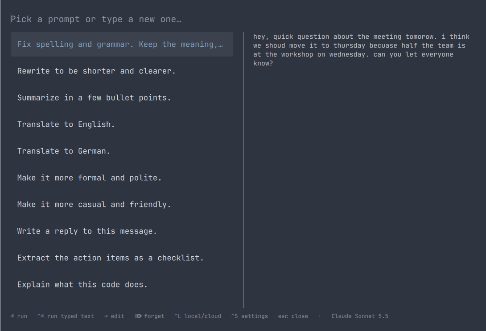

# MagiClip

**The magic clipboard.** An [Omarchy](https://omarchy.org/) shell overlay that runs your clipboard text
through Claude, or through a local model with Ollama. Copy some text, press the hotkey, pick a prompt (or type a new
one), and read the answer before copying it, or let it replace the clipboard
silently. A bar button holds the settings.



## Use

| Key | Action |
|---|---|
| type | filter saved prompts; if nothing matches exactly, the typed text is offered as a new prompt (`+` row) |
| `Enter` | run the selected prompt |
| `Ctrl+Enter` | run exactly what you typed, even if a saved prompt matches |
| `Tab` | copy the selected prompt into the field to edit it |
| `Shift+Delete` | forget the selected prompt |
| `Ctrl+S` | settings |
| `Ctrl+L` | switch between Claude and the local model for this run (the footer shows which) |
| `Esc` | clear the field, then close |

With **Show result** (the default) the answer appears in the overlay:

| Key | Action |
|---|---|
| `Enter` | copy the answer and close |
| `Shift+Enter` | copy it and paste it into the window you came from (Shift+Insert) |
| `Ctrl+R` | ask again |
| `Ctrl+L` | ask again with the other backend |
| `Backspace` | back to the prompts |
| `Esc` | discard and close |

With **Replace silently** the overlay closes right away; the answer replaces the
clipboard and a notification shows when it's done.

## Settings

Click the bar button (right-click runs the overlay), or press `Ctrl+S` in the
overlay. Settings are saved in `~/.config/magiclip/config.json`:

| Key | Values |
|---|---|
| `mode` | `review` (show result) or `silent` |
| `backend` | `claude` (default) or `local` |
| `model` | `claude-haiku-5-5`, `claude-sonnet-5-5` (default), `claude-opus-5-5`, `claude-fable-5-1` |
| `effort` | `low` (default), `medium`, `high` |
| `localUrl` | Ollama server, default `http://localhost:11434` |
| `localModel` | Ollama model; empty = the first one installed |
| `instructions` | "Always apply": standing preferences added to every request, e.g. `German uses Swiss spelling (ss, not ß).` or `Never use em dashes.` |
| `showInBar` | `false` hides the bar button; settings stay in the overlay |

The model, backend and "Always apply" options are on the **Advanced** page.
The prompts can be edited, reordered, added, removed or reset to the defaults
there too.

Every prompt you run moves to the top of the list and is saved in
`~/.local/state/magiclip/prompts.json` (most recent first, up to 100). The
list starts with a set of default prompts; delete any you don't want.

The original text stays in the clipboard manager's history (`Super+Ctrl+V`).

## Local models

Install Ollama (`ollama-cuda` on NVIDIA), start it with
`systemctl enable --now ollama`, and pull a model, e.g. `ollama pull qwen3:8b`
(5 GB; about 7.5 GB of VRAM with the 16k context MagiClip asks for).
The Advanced page finds the installed models itself (`/api/tags`); pick one
from the list. Thinking is switched off for speed, and leftover
`<think>` blocks are removed. A warm request takes about a second. An 8B
model is fine for translation and rewording but misses grammar fixes Claude catches.

## Install

Needs a recent [Omarchy](https://omarchy.org/) (4.5 or later; it is an Omarchy shell plugin), `curl`, `jq`,
`wl-clipboard` and `wtype`. Elsewhere only the [runner](#runner) works, from the terminal.

```sh
git clone https://github.com/tilman-schieber/magiclip ~/src/magiclip
ln -s ~/src/magiclip ~/.config/omarchy/plugins/io.github.tilman-schieber.magiclip
```

For Claude you need your own Anthropic API key ([console.anthropic.com](https://console.anthropic.com/)). Put it
in `~/.config/magiclip/api-key`, or set `ANTHROPIC_API_KEY`:

```sh
mkdir -p ~/.config/magiclip
install -m 600 /dev/null ~/.config/magiclip/api-key
$EDITOR ~/.config/magiclip/api-key   # paste the key
```

Without a key, use a [local model](#local-models) instead.

Put the bar button on the bar (this also enables the overlay):

```sh
omarchy bar put io.github.tilman-schieber.magiclip
```

Bind a key in `~/.config/hypr/bindings.lua`:

```lua
o.bind("SUPER + ALT + V", "MagiClip", "omarchy-shell shell toggle io.github.tilman-schieber.magiclip")
```

and run `omarchy restart shell`.

## Runner

`bin/magiclip [--print] [--local|--cloud] "<instruction>"` does the actual work and can be used on its
own. It reads the clipboard text, calls the Messages API with the configured
model and effort (with the server-side refusal fallback, except on Haiku), and
copies the answer with `wl-copy`; `--print` writes it to stdout instead, which
is what the overlay uses. `--local`/`--cloud` override the backend for one
run, and `--list-local` prints the installed Ollama models. The last raw response is kept in
`~/.local/state/magiclip/last-response.json` for debugging.

| Variable | Default |
|---|---|
| `ANTHROPIC_API_KEY` | falls back to `~/.config/magiclip/api-key`, then fish's universal variables |
| `MAGICLIP_MODEL` | overrides `model` from config.json |
| `MAGICLIP_EFFORT` | overrides `effort` from config.json |
| `MAGICLIP_LOCAL_MODEL` | overrides `localModel` from config.json |

The shell is not started from fish, so a key set with `set -U` is not in its
environment; the runner asks fish for it.

Needs `curl`, `jq`, `wl-clipboard`, `wtype`.

## License

MIT, see [LICENSE](LICENSE).
